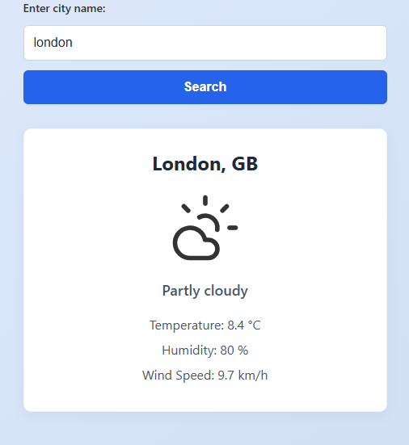

# Weather Dashboard

A responsive weather dashboard built with **Vanilla JavaScript**, fetching real-time weather data through the Open-Meteo API.

The project focuses on practical implementation of modern JavaScript concepts, including asynchronous operations, API integration, DOM manipulation, and request management.


[](https://ali-ahmed-dev.github.io/weather-dashboard/)

## Preview



## 📌 Features

- **City Search:** Search for cities using the Open-Meteo Geocoding API.
- **Current Weather:** Retrieve and display temperature, humidity, wind speed, and weather conditions.
- **Dynamic Weather Icons:** Display weather-specific icons based on WMO weather codes and daylight conditions.
- **Loading State:** Provide visual feedback while weather data is being retrieved.
- **Input Validation:** Prevent empty search submissions.
- **Error Handling:** Handle unsuccessful HTTP responses, network errors, and missing search results.
- **Request Cancellation:** Use `AbortController` to cancel previous requests when a new search starts, preventing outdated requests from interfering with the latest search.
- **Responsive Design:** Adapt the interface to different screen sizes.

## 🛠️ Technologies Used

| Technology | Usage |
|---|---|
| HTML5 | Application structure |
| CSS3 | Styling and responsive layout |
| JavaScript (ES6+) | Application logic and DOM manipulation |
| Fetch API | HTTP requests |
| Async/Await | Asynchronous operations |
| URLSearchParams | Query string construction |
| AbortController | Request cancellation |
| Open-Meteo API | Geocoding and weather data |
| Lucide Icons | Dynamic weather icons |

## 🔗 API Integration

The application uses two Open-Meteo services:

- **Geocoding API:** Searches for cities and retrieves their geographic coordinates.
- **Forecast API:** Retrieves current weather data using latitude and longitude.

The application requests the following weather parameters:

- Temperature
- Relative Humidity
- Wind Speed
- Weather Code
- Day/Night Indicator

No API key is required for non-commercial use.

- [Open-Meteo Documentation](https://open-meteo.com/en/docs)
- [Geocoding API](https://open-meteo.com/en/docs/geocoding-api)

## 📁 Project Structure

```text
weather-dashboard/
├── index.html
├── style.css
├── app.js
├── preview.png
├── README.md
└── LICENSE
```

## ▶️ Installation & Usage

Clone the repository:

```bash
git clone https://github.com/ali-ahmed-dev/weather-dashboard.git
cd weather-dashboard
```

Open `index.html` in your browser to run the application.

## 📄 License

This project is licensed under the **MIT License**. See the [LICENSE](LICENSE) file for details.

## Author

**Ali Ahmed**

- GitHub: [@ali-ahmed-dev](https://github.com/ali-ahmed-dev)
- Project Repository: [weather-dashboard](https://github.com/ali-ahmed-dev/weather-dashboard)